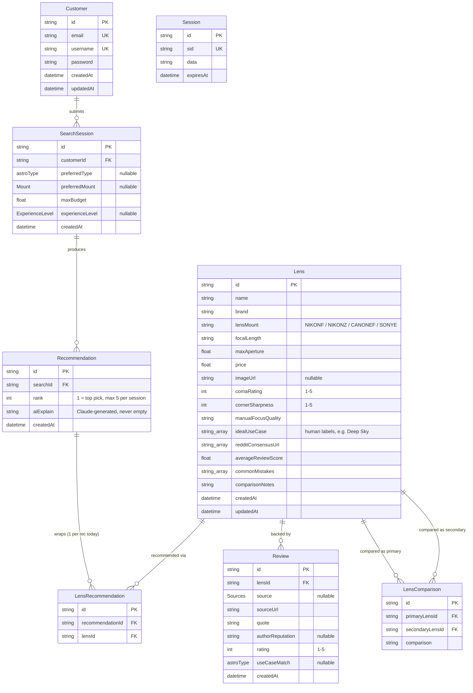

# Database Schema

Source of truth: [`prisma/schema.prisma`](../prisma/schema.prisma). Regenerate this diagram by hand if the schema changes -- it's not auto-synced.

## Notes for readers

- **`Session` is unrelated to `SearchSession`.** `Session` looks like scaffolding for a future auth/cookie-session mechanism (`sid` + opaque `data` blob) -- nothing in the current codebase reads or writes it yet.
- **`Lens.lensMount` and `Lens.idealUseCase` are plain strings, not foreign keys into the enums.** `lensMount` is validated at seed time against the `Mount` enum's values (`prisma/seed.ts`); `idealUseCase` stores human-readable labels ("Deep Sky") rather than raw enum values ("DEEPSKY") because that's what `lib/utils/scoring.ts` compares against (`ASTRO_TYPE_LABELS` in `lib/utils/constants.ts` is the mapping). Both are worth turning into real relations/enums if the schema gets revisited.
- **One `Lens` row per supported mount.** A physical lens sold in multiple mounts (e.g. the Samyang/Rokinon 14mm f/2.8, available in Nikon F / Canon EF / Sony E) is seeded as 3 separate `Lens` rows, one per mount, rather than one row with a mount array -- `lensMount` is a single string per row.
- **`LensRecommendation` is a join table with headroom it doesn't use yet.** Today each `Recommendation` always wraps exactly one `LensRecommendation`/`Lens`; the `@@unique([recommendationId, lensId])` constraint would also support a future many-lenses-per-recommendation case (e.g. bundling a body + lens kit) without a schema change.
- **Deleting a `Lens` is blocked (`RESTRICT`) while any `LensRecommendation` still references it**, but deleting a `Recommendation` cascades to its `LensRecommendation` rows. Re-seeding must clear `Recommendation`/`SearchSession` before `Lens` -- see the ordering comment in `prisma/seed.ts`.
