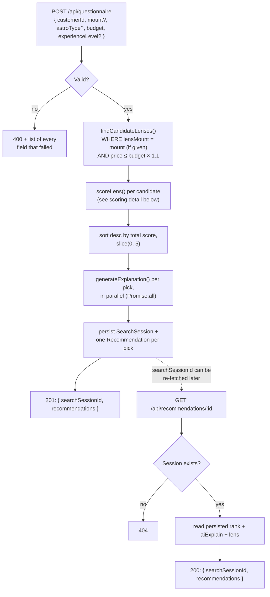
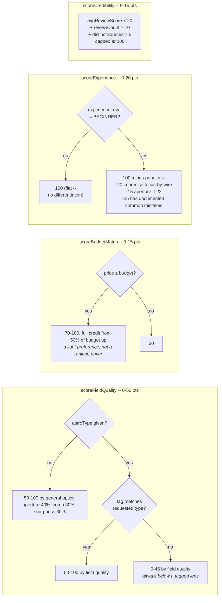

# Recommendation Algorithm

How a questionnaire submission turns into 5 ranked, explained lens picks. Source: `lib/services/recommendationEngine.ts`, `lib/services/lensQuery.ts`, `lib/utils/scoring.ts`, `lib/services/explanationGenerator.ts`.

## End-to-end flow

## Scoring detail (per candidate lens)

Weighted model, revised from the Week 1 spec (Budget 35 / Astro fit 30 / Experience 20 / Credibility 15) so a lens's quality for the user's field outranks its price: **Field quality 50% + Experience 20% + Budget 15% + Credibility 15%**. Each sub-scorer computes a 0-100 raw value, which is then weighted and clamped to its slice of the 100-point total.

`total = fieldQuality + experience + budget + credibility`, each already clamped to its max (50/20/15/15) before summing, so `total` never exceeds 100.

### Field quality by astro type

Each property is rated 0-1. Aperture and focal length use a log scale, because each doubling matters about equally.

| Astro type | What it measures (weights sum to 1) |
|---|---|
| Milky Way | Aperture 35%, coma 25%, wide angle 25% (14mm or wider is best, 35mm or longer scores 0), corner sharpness 15% |
| Deep Sky | Aperture, coma, corner sharpness and reach (50mm to 300mm), 25% each |
| Planetary | Reach 65% (50mm to 800mm), corner sharpness 25%, aperture 10% |
| Lunar | Reach 55% (50mm to 800mm), corner sharpness 35%, aperture 10% |

Aperture runs from f/5.6 or slower (0) to f/1.4 or faster (1). Coma and corner sharpness come from the 1-5 ratings in `prisma/lenses.json`, so the accuracy of those ratings now shapes the top picks.

## Why this shape

- **Quality for the field drives the ranking, not price.** Field quality carries half the score. Budget carries 15% and moves in-budget lenses by at most 4.5 points, so a great cheaper lens can beat a pricier one. Premium lenses still rise on a big budget because they tend to be faster and sharper, not because they cost more.
- **The candidate filter is a hard mount match, soft budget match.** `findCandidateLenses` excludes wrong-mount lenses entirely, but admits lenses up to 10% over budget. Those score 30 of 100 on budget, below any in-budget lens.
- **A lens tagged for the field always ranks first.** Untagged lenses are capped below the tagged floor, so they only appear when the mount and budget don't offer enough tagged lenses. When that happens, the field-quality formula still ranks them sensibly, for example a 200mm ahead of a 14mm for planets.
- **The API is honest about weak matches.** When a lens isn't tagged for the requested type, the API returns `matchesAstroType: false` and the explanation says it isn't a dedicated lens instead of pitching it as a good fit.
- **Each lens appears once, in a predictable order.** A lens sold in several mounts is one row per mount, so `rankLenses` keeps only the best-scoring row per lens name before taking the top 5. On a tied score, the cheaper lens ranks first.
- **Explanation generation never blocks or fails the request.** `generateExplanation` catches Claude timeouts/rate-limits/API errors internally and falls back to a deterministic sentence, so a Claude hiccup for one lens can't take down the other four or the whole `POST /api/questionnaire` call. Explanations are also cached in-memory per `(lensId, astroType, budgetTier, experienceLevel)` bucket to cut down on repeat API calls for common combinations.
- **The weights and formulas were deliberately reworked** from the original Week 1 spec -- see `reports/week3-wed-thu-data-validation-report.md` for the edge cases that motivated it. The original budget formula let the cheapest lens dominate, and the first fix for that made price the main signal for quality.
