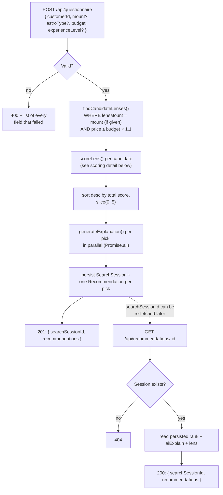
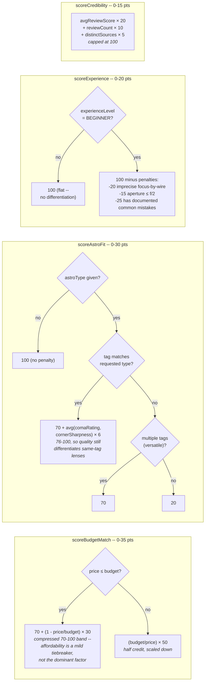

# Recommendation Algorithm

How a questionnaire submission turns into 5 ranked, explained lens picks. Source: `lib/services/recommendationEngine.ts`, `lib/services/lensQuery.ts`, `lib/utils/scoring.ts`, `lib/services/explanationGenerator.ts`.

## End-to-end flow

## Scoring detail (per candidate lens)

Weighted model from the Week 1 algorithm spec, unchanged since then: **Budget 35% + Astro fit 30% + Experience 20% + Credibility 15%**. Each sub-scorer computes a 0-100 raw value, which is then weighted and clamped to its slice of the 100-point total.

`total = budget + astroFit + experience + credibility`, each already clamped to its max (35/30/20/15) before summing, so `total` never exceeds 100.

## Why this shape

- **The candidate filter is a hard mount match, soft budget match.** `findCandidateLenses` excludes wrong-mount lenses entirely, but admits lenses up to 10% over budget -- the over-budget half-credit penalty in `scoreBudgetMatch` is what keeps those from usually winning, not the filter itself.
- **Astro fit degrades gracefully with no signal.** No `astroType` given -> every lens scores a full 30, so the ranking falls back to budget + experience + credibility. Also what happens today when a requested astro type has zero matching lenses in the catalog (e.g. Planetary, as of the Week 3 Wed-Thu validation pass) -- nothing crashes, it just can't meaningfully differentiate.
- **Explanation generation never blocks or fails the request.** `generateExplanation` catches Claude timeouts/rate-limits/API errors internally and falls back to a deterministic sentence, so a Claude hiccup for one lens can't take down the other four or the whole `POST /api/questionnaire` call. Explanations are also cached in-memory per `(lensId, astroType, budgetTier, experienceLevel)` bucket to cut down on repeat API calls for common combinations.
- **The two numbers above (70-100 budget band, coma-blended astro fit) were a deliberate rework**, not the original Week 2 formula -- see `reports/week3-wed-thu-data-validation-report.md` for the edge cases that motivated it (the original budget formula spanned the full 0-100 range and let "cheapest lens" dominate regardless of how large the user's budget was).
